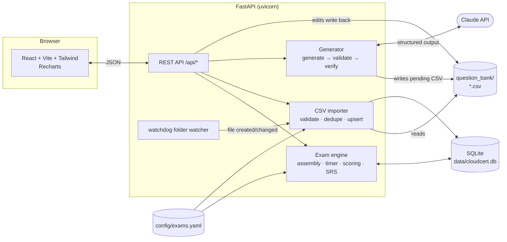

# CloudCert Lab

A local practice-exam platform for three AWS certifications:

| Exam | Questions | Time | Passing score |
|---|---|---|---|
| AWS Certified Cloud Practitioner (CLF-C02) | 65 | 90 min | 700 / 1000 |
| AWS Certified Solutions Architect – Associate (SAA-C03) | 65 | 130 min | 720 / 1000 |
| AWS Certified Solutions Architect – Professional (SAP-C02) | 75 | 180 min | 750 / 1000 |

It runs on your machine with one command, needs no login, and keeps your progress in a local SQLite
database. All exam settings (counts, timers, passing scores, domain weights, task statements) live in
[`config/exams.yaml`](config/exams.yaml).

> **Check the exam formats.** The settings above follow the AWS exam guides as of late 2026. AWS revises
> exams from time to time; compare with the official pages linked in `config/exams.yaml` and edit that
> file if anything changes. Nothing else needs to change.

## Quick start (macOS)

Requirements: Python 3.10+ and Node.js 18+ (`brew install python@3.12 node`).

```bash
make run
```

Then open http://localhost:8000. The first run creates `.venv/`, installs dependencies, builds the
frontend, imports the question bank, and starts the server. Your data is stored in `data/cloudcert.db`.

If `python3` on your Mac is older than 3.10, point the Makefile at a newer one:

```bash
make run PYTHON=python3.12
```

### Other commands

```bash
make dev        # backend with auto-reload + Vite dev server (http://localhost:5173)
make test       # backend unit tests
make import     # import all CSVs in question_bank/ (normally automatic)
make seed       # generate ~100 original questions per exam with Claude (needs an API key)
make docker     # same app in Docker: docker compose up --build
```

### Docker

```bash
cp .env.example .env   # optional: add your API key
docker compose up --build
```

`question_bank/` and `data/` are mounted from your machine, so CSV drops and progress survive restarts.

## What's inside

**Four test modes**

1. **Full exam simulation**: the exact question count and time limit, questions drawn by domain
   weight, a countdown with 15- and 5-minute warnings, automatic submission at zero, one question per
   screen, flagging, a navigator grid, and a review screen before you submit. No answers until the end.
2. **Practice**: untimed or a custom timer, with the answer and explanation after each question
   (or at the end, if you prefer).
3. **Domain drills**: 10–25 questions from one domain or one AWS service tag.
4. **Weak-area review**: retests questions you missed or flagged, using spaced repetition (Leitner
   boxes): wrong answers come back immediately, correct ones come back after 1, 3, 7, 14, then 30 days.

Before every test you pick an exam and a difficulty: **Easy** (definitions and recall), **Medium**
(right service for a need), **Hard** (multi-service tradeoffs), **Tough** (long professional
scenarios, multiple-response), or **Mixed** (a realistic blend set per exam in `exams.yaml`).

**Results**: an estimated scaled score (100–1000) against the passing line, raw percent, pass/fail,
total and average time per question, charts by domain and by difficulty, and a full answer review
with explanations and AWS documentation links. **History** lists every attempt with a score trend per
exam. **Readiness** on the dashboard is based on your last three full simulations.

**Keyboard shortcuts** during a test: `1`–`6` select an option · `N` next · `P` previous · `F` flag ·
`Enter` check answer (practice).

**Light and dark mode** follow your system setting, and you can switch with the toggle in the header.

### About the score

AWS reports scaled scores from 100 to 1000 and does not publish how raw answers map to them; real exams
also include unscored questions. CloudCert Lab maps raw percent to the scale linearly, so that an
assumed raw cut (70% for CLF, 72% for SAA, 75% for SAP, set by `estimated_raw_cut_pct`) lands exactly
on the passing score. **Treat it as an estimate.** Multiple-response questions are all-or-nothing:
every correct option and no incorrect ones, with no partial credit.

## Questions

The repository ships with **299 original practice questions** (about 100 per exam) in
`question_bank/<exam>/seed-d*.csv`. They are spread across domains by the exam-guide weights and across
difficulties by each exam's blend. They were written for this project from the exam guides' task
statements. They are **not** taken from real exams, exam dumps, or third-party question banks, which
would break the AWS Certification Program Agreement and those sites' copyrights. If you spot a question
that is wrong or out of date, fix the row in the CSV; the app picks up the change.

### Add your own: the CSV drop folder

Drop CSV files into `question_bank/clf-c02/`, `saa-c03/`, or `sap-c02/`. The app watches the folder and
imports new or changed files automatically. You can also use **Import now** or **Upload** on the
Question bank page, or `make import`. Every row is validated, bad rows are skipped, and the import
report lists each skipped row number with the reason. Questions are deduplicated by normalized text,
so editing a CSV updates questions instead of duplicating them.

Start from [`question_bank/TEMPLATE.csv`](question_bank/TEMPLATE.csv); the full format is in
[`question_bank/README.md`](question_bank/README.md). Columns:

```
exam, domain, difficulty, question_type, question, option_a, option_b, option_c, option_d,
option_e, option_f, correct, explanation, services, reference_url[, status]
```

### Generate more: the AI question generator

Add `ANTHROPIC_API_KEY` to `.env` and restart. Then use the **Review & generate** page, or the CLI:

```bash
cd backend
../.venv/bin/python -m app.cli generate --exam saa-c03 --domain 2 --difficulty hard --count 5
../.venv/bin/python -m app.cli seed --exam all --per-exam 100     # same as: make seed
```

How it works:

1. **Generate.** Claude writes original questions for the chosen exam, domain, and difficulty, guided by
   that domain's task statements from `exams.yaml`. Each has 4–6 options, plausible distractors, the
   answer, an explanation, a right/wrong reason for every option, service tags, and an AWS
   documentation link. Existing questions are passed in so new ones cover different ground.
2. **Validate.** The JSON output is requested with a structured-output schema and then validated with
   Pydantic (letters, answer counts, "Choose TWO/THREE" labels, official AWS doc links). Malformed JSON
   or schema errors are sent back to the model to fix, up to 3 attempts.
3. **Verify.** A second model pass reviews every question for ambiguity, outdated service facts, and
   more than one defensible answer. It returns pass, fix (with a corrected question), or fail.
   Failures are discarded and reported.
4. **Review.** Survivors are saved as `question_bank/<exam>/generated/<timestamp>-d<N>-<difficulty>.csv`
   with `status=pending` and imported. They stay out of tests until you **approve**, **edit**, or
   **reject** them on the Review screen. Your decision is written back to the CSV.

The model defaults to `claude-opus-5-5` and can be changed with `CLOUDCERT_MODEL` and
`CLOUDCERT_VERIFIER_MODEL` in `.env`. To try the pipeline without an API key, run `make seed-demo`. It
writes a few placeholder `[DEMO]` questions as pending, so you can exercise the Review screen and then
reject them.

## Architecture



- The **timer is enforced on the server**. Each attempt stores a deadline. Any request after it (plus
  a 3-second grace period) auto-submits the attempt, and abandoned timed attempts are submitted the
  next time the app looks at them. The browser counts down and submits at zero.
- **Answers are never sent to the browser** during a full simulation; they come with the results.
- **CSV files are the source of truth** for questions; the database adds history and review state.

### Project layout

```
backend/app/
  main.py            FastAPI app, startup import, folder watcher, serves the built frontend
  exams.py           loads config/exams.yaml
  bank/              CSV validation, import/dedupe, watcher
  engine/            test assembly, attempts and timer, scoring, spaced repetition, readiness
  generator/         Claude client, prompts, Pydantic schemas, generate/verify pipeline, demo client
  api/               HTTP routes
  cli.py             import / generate / seed / stats
backend/tests/       pytest suite
frontend/src/        React pages: Dashboard, StartTest, ExamRunner, Results, History, Bank, Review
config/exams.yaml    exam formats, domains, task statements, difficulty blends, SRS intervals
question_bank/       CSV question files (+ TEMPLATE.csv and format docs)
```

## Tests

```bash
make test
```

The suite covers CSV validation (each rule and the row-numbered report), deduplication and updates,
test assembly by domain weights and difficulty blend (including shortfall redistribution), timer
auto-submit (frozen clock), scoring (multiple-response all-or-nothing, scaled score mapping,
breakdowns), spaced repetition, the generator (Pydantic validation, retry on malformed JSON, verifier
pass/fix/fail, pending CSV output) using a fake LLM, and the main API flows.

## Configuration reference (`.env`)

| Variable | Default | Purpose |
|---|---|---|
| `ANTHROPIC_API_KEY` | – | Enables the generator. Nothing else needs it. |
| `CLOUDCERT_MODEL` | `claude-opus-5-5` | Model that writes questions |
| `CLOUDCERT_VERIFIER_MODEL` | same as above | Model for the review pass |
| `CLOUDCERT_EFFORT` | `high` | Reasoning effort for both passes |
| `CLOUDCERT_FALLBACKS` | `1` | If the model declines a request, the API retries it on a fallback model |
| `CLOUDCERT_WATCH` | `1` | Auto-import CSV changes |
| `CLOUDCERT_WATCH_POLLING` | `0` | Poll instead of OS file events (Docker/network drives) |
| `CLOUDCERT_DATA_DIR` | `data` | Where the SQLite database lives |
